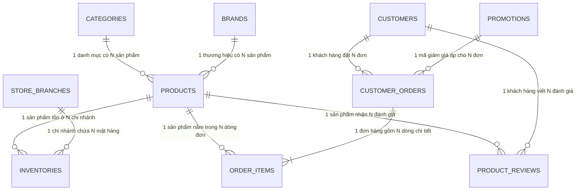

# 02. Thiết Kế Cơ Sở Dữ Liệu 10 Bảng, Sơ Đồ ERD & Quy Tắc JPA Mapping

> **Chủ đề nguyên tử (Atomic Scope):** Đặc tả toàn diện sơ đồ thực thể quan hệ (ERD), lược đồ vật lý của **10 bảng CSDL MWG**, các JPA Annotations sử dụng và chiến lược xử lý khóa ngoại, chống lặp JSON vô tận (`Circular Reference`) và `Cascade` / `Orphan Data`.
>
> **Không chứa:** Kiến trúc tầng ứng dụng (xem [`01-system-architecture.md`](./01-system-architecture.md)) hoặc đặc tả REST API (xem [`03-rest-api-specification.md`](./03-rest-api-specification.md)).

---

## 1. Đối Chiếu Quy Chuẩn CSDL & JPA Của Thầy (Kèm Mốc Thời Gian)

| Quy chuẩn của Giảng viên | Lời thầy dặn trên bài giảng | Mốc thời gian trích dẫn |
| :--- | :--- | :--- |
| **Quy mô số bảng CSDL** | Tối thiểu **6 bảng**, khung chuẩn đẹp nhất là **6 – 10 bảng** (*"từ 6 đến 10 là ok rồi, 10 là cũng hơi nhiều à"*). Dự án thiết kế đúng **10 bảng** nghiệp vụ bán lẻ. | [PL1-B11 `53:33`–`54:47`](https://www.youtube.com/watch?v=_0lFUb8cU4I&t=53m33s) \| [PL2-S10 `55:32`–`56:46`](https://www.youtube.com/watch?v=kuJZxQC4n_4&t=55m32s) |
| **Độ sâu phân cấp đạt điểm 10** | Master–Detail 2 cấp mới đạt trần **8/10**; muốn đạt **10/10** phải thiết kế liên kết đa tầng và lọc đa chiều. Dự án liên kết 4 tầng: `Category`/`Brand` → `Product` → `Inventory`/`StoreBranch` & `OrderItem` → `CustomerOrder`. | [PL2-S04 `27:45`–`28:44`](https://www.youtube.com/watch?v=xMQSY7vEis4&t=27m45s) |
| **Phương pháp Code-First** | Khai báo class Java gắn `@Entity`, `@Table`, `@Id`, `@Column`; Hibernate tự động sinh bảng trong MySQL mà không cần viết tay lệnh `CREATE TABLE`. | [PL1-B09 `38:56`–`44:01`](https://www.youtube.com/watch?v=tsVNKKGGZRA&t=38m56s), [PL1-B11 `41:56`](https://www.youtube.com/watch?v=_0lFUb8cU4I&t=41m56s) \| [PL2-S08 `38:56`–`44:39`](https://www.youtube.com/watch?v=GLNPlwPn_bg&t=38m56s) |
| **ERD vs Lược đồ vật lý** | Phải phân biệt Lược đồ phân tích (ERD) và Lược đồ vật lý trên MySQL Workbench (thể hiện rõ PK, FK và dây nối). Chốt kỹ ERD từ đầu vì sửa ERD sẽ làm gãy toàn bộ code phía trên. | [PL1-B10 `12:00`–`20:43`](https://www.youtube.com/watch?v=puX0LDumypE&t=12m00s) \| [PL2-S09 `07:49`–`16:40`](https://www.youtube.com/watch?v=Ac686eKMcd4&t=7m49s) |
| **Quan hệ 1–N & Bẫy Circular Reference** | Bên Nhiều gắn `@ManyToOne` + `@JoinColumn`; bên Một gắn `@OneToMany(mappedBy = "...")`. Phải chặn tham chiếu vòng lặp 2 chiều (`Circular Reference`) khi serialize JSON. | [PL1-B10 `28:53`–`32:48`](https://www.youtube.com/watch?v=puX0LDumypE&t=28m53s) \| [PL2-S09 `26:16`–`32:38`](https://www.youtube.com/watch?v=Ac686eKMcd4&t=26m16s) |
| **Chiến lược Cascade vs Orphan Data** | Hiểu rõ tác động khi xóa bản ghi cha: dùng `Cascade` sẽ xóa tự động bản ghi con, không dùng sẽ phát sinh dữ liệu mồ côi (*orphan data*) hoặc bị khóa ngoại chặn lại tùy nghiệp vụ. | [PL1-B10 `32:48`–`33:58`](https://www.youtube.com/watch?v=puX0LDumypE&t=32m48s) \| [PL2-S09 `32:38`–`35:07`](https://www.youtube.com/watch?v=Ac686eKMcd4&t=32m38s) |

---

## 2. Sơ Đồ Thực Thể Quan Hệ (ERD 10 Bảng Chuẩn)

> **Lưu ý kiểm toán:** Bảng thừa `students` (`Student.java`) từ bài mẫu cũ **không thuộc mô hình này** và bắt buộc phải xóa khỏi `backend/` trong Bước 1 của kế hoạch thực thi.



### Bản chất phân rã bảng trung gian N–N thành hai quan hệ 1–N có thuộc tính riêng:
1. **`products` ↔ `store_branches` tách qua `inventories`:** Một sản phẩm bán ở nhiều chi nhánh và một chi nhánh có nhiều sản phẩm, nhưng mối liên kết này mang thuộc tính nghiệp vụ **`quantity` (số lượng tồn)** nên phải tách thành thực thể `Inventory` có ràng buộc duy nhất `UNIQUE(product_id, branch_id)`.
2. **`customer_orders` ↔ `products` tách qua `order_items`:** Mỗi dòng chi tiết đơn hàng phải lưu riêng `quantity` và **`unit_price` (đơn giá chốt tại thời điểm mua)** để khi giá niêm yết `products.price` tăng/giảm trong tương lai thì lịch sử doanh thu đơn hàng cũ không bị sai lệch.

---

## 3. Đặc Tả Vật Lý Chi Tiết 10 Bảng CSDL

### Phân hệ 1 — Danh mục, Thương hiệu & Sản phẩm (Phụ trách: Phạm Ngọc Lang)

| STT | Tên bảng (`@Table`) | Class Entity | Khóa chính (`@Id`) | Các cột thuộc tính & Ràng buộc (`@Column`) | Khóa ngoại (`@JoinColumn`) |
| :-: | :--- | :--- | :--- | :--- | :--- |
| **1** | `categories` | `Category` | `id` (`BIGINT`, `IDENTITY`) | `name` (`VARCHAR(100)`, `NOT NULL`), `code` (`VARCHAR(50)`, `NOT NULL`, `UNIQUE`), `description` (`VARCHAR(255)`) | *(Không có — Bảng cha)* |
| **2** | `brands` | `Brand` | `id` (`BIGINT`, `IDENTITY`) | `name` (`VARCHAR(100)`, `NOT NULL`, `UNIQUE`), `country` (`VARCHAR(100)`), `description` (`VARCHAR(255)`) | *(Không có — Bảng cha)* |
| **3** | `products` | `Product` | `id` (`BIGINT`, `IDENTITY`) | `sku` (`VARCHAR(50)`, `NOT NULL`, `UNIQUE`), `name` (`VARCHAR(200)`, `NOT NULL`), `price` (`DOUBLE`, `NOT NULL`), `description` (`TEXT`) | `category_id` → `categories.id`<br>`brand_id` → `brands.id` |

### Phân hệ 2 — Chi nhánh Siêu thị, Tồn kho & Đánh giá (Phụ trách: Bùi Dương Diễm)

| STT | Tên bảng (`@Table`) | Class Entity | Khóa chính (`@Id`) | Các cột thuộc tính & Ràng buộc (`@Column`) | Khóa ngoại (`@JoinColumn`) |
| :-: | :--- | :--- | :--- | :--- | :--- |
| **4** | `store_branches` | `StoreBranch` | `id` (`BIGINT`, `IDENTITY`) | `branch_name` (`VARCHAR(150)`, `NOT NULL`), `district` (`VARCHAR(100)`, `NOT NULL`), `address` (`VARCHAR(255)`, `NOT NULL`), `phone` (`VARCHAR(20)`) | *(Không có — Bảng cha)* |
| **5** | `inventories` | `Inventory` | `id` (`BIGINT`, `IDENTITY`) | `quantity` (`INT`, `NOT NULL`), ràng buộc cấp bảng `@UniqueConstraint(columnNames = {"product_id", "branch_id"})` | `product_id` → `products.id`<br>`branch_id` → `store_branches.id` |
| **6** | `product_reviews` | `ProductReview` | `id` (`BIGINT`, `IDENTITY`) | `rating` (`INT`, `NOT NULL`, 1–5), `comment` (`TEXT`), `review_date` (`DATETIME`, `NOT NULL`) | `product_id` → `products.id`<br>`customer_id` → `customers.id` |

### Phân hệ 3 — Khách hàng, Khuyến mãi & Đơn đặt hàng (Phụ trách: Nguyễn Thanh Toàn)

| STT | Tên bảng (`@Table`) | Class Entity | Khóa chính (`@Id`) | Các cột thuộc tính & Ràng buộc (`@Column`) | Khóa ngoại (`@JoinColumn`) |
| :-: | :--- | :--- | :--- | :--- | :--- |
| **7** | `customers` | `Customer` | `id` (`BIGINT`, `IDENTITY`) | `full_name` (`VARCHAR(100)`, `NOT NULL`), `phone` (`VARCHAR(20)`, `NOT NULL`, `UNIQUE`), `email` (`VARCHAR(150)`), `address` (`VARCHAR(255)`) | *(Không có — Bảng cha)* |
| **8** | `promotions` | `Promotion` | `id` (`BIGINT`, `IDENTITY`) | `promo_code` (`VARCHAR(50)`, `NOT NULL`, `UNIQUE`), `discount_percent` (`DOUBLE`, `NOT NULL`), `description` (`VARCHAR(255)`), `is_active` (`BOOLEAN`, `NOT NULL`) | *(Không có — Bảng cha)* |
| **9** | `customer_orders` | `CustomerOrder` | `id` (`BIGINT`, `IDENTITY`) | `customer_name` (`VARCHAR(100)`, `NOT NULL`), `phone` (`VARCHAR(20)`, `NOT NULL`), `shipping_address` (`VARCHAR(255)`, `NOT NULL`), `total_amount` (`DOUBLE`, `NOT NULL`), `status` (`VARCHAR(50)`, `NOT NULL`), `order_date` (`DATETIME`, `NOT NULL`) | `customer_id` → `customers.id` *(nullable cho khách vãng lai)*<br>`promotion_id` → `promotions.id` *(nullable)* |
| **10** | `order_items` | `OrderItem` | `id` (`BIGINT`, `IDENTITY`) | `quantity` (`INT`, `NOT NULL`), `unit_price` (`DOUBLE`, `NOT NULL`) | `order_id` → `customer_orders.id`<br>`product_id` → `products.id` |

---

## 4. Quy Tắc Ánh Xạ JPA Annotations Bắt Buộc Ghi Nhớ

1. **Khóa chính tự tăng trong MySQL:**
   ```java
   @Id
   @GeneratedValue(strategy = GenerationType.IDENTITY)
   private Long id;
   ```
   *(MySQL dùng cơ chế `AUTO_INCREMENT` nên chiến lược chuẩn nhất là `GenerationType.IDENTITY`).*

2. **Chiều sở hữu khóa ngoại (Owning Side — Bên Nhiều) vs Chiều nghịch (Inverse Side — Bên Một):**
   ```java
   // Bên Nhiều (Product.java) — Nơi thực sự giữ cột khóa ngoại category_id
   @ManyToOne
   @JoinColumn(name = "category_id", nullable = false)
   private Category category;

   // Bên Một (Category.java) — Chỉ tham chiếu ngược qua mappedBy, ngắt lặp JSON bằng @JsonIgnore
   @OneToMany(mappedBy = "category")
   @JsonIgnore
   private List<Product> products = new ArrayList<>();
   ```
   * **Tại sao bắt buộc có `mappedBy`?** Để báo cho Hibernate biết cột khóa ngoại đã do thuộc tính `category` bên `Product` quản lý, ngăn Hibernate tự sinh thêm bảng trung gian thừa ([PL1-B10 `31:48`](https://www.youtube.com/watch?v=puX0LDumypE&t=31m48s) | [PL2-S09 `29:30`](https://www.youtube.com/watch?v=Ac686eKMcd4&t=29m30s)).
   * **Tại sao bắt buộc có `@JsonIgnore`?** Để ngắt vòng lặp đệ quy vô hạn (`Category -> List<Product> -> Category -> ...`) gây `StackOverflowError` khi Jackson chuyển Entity thành JSON ([PL1-B10 `31:28`](https://www.youtube.com/watch?v=puX0LDumypE&t=31m28s)). *(Lưu ý ngoại lệ duy nhất: `CustomerOrder.orderItems` KHÔNG gắn `@JsonIgnore`, thay vào đó gắn `@JsonIgnore` ở `OrderItem.customerOrder` để khi xem chi tiết 1 đơn hàng thì JSON trả kèm danh sách món hàng bên trong!).*

3. **Quy chuẩn dùng `Cascade` đúng nghiệp vụ bán lẻ:**
   * **NÊN dùng `cascade = CascadeType.ALL, orphanRemoval = true`** trên `CustomerOrder.orderItems`: Khi hủy/xóa một đơn hàng nháp, các dòng chi tiết `order_items` phụ thuộc hoàn toàn vào đơn đó nên xóa theo là hợp lý.
   * **KHÔNG NÊN để `CascadeType.REMOVE` (nằm trong `CascadeType.ALL`)** trên `Category.products` hoặc `Brand.products`: Trong thực tế siêu thị, xóa nhầm 1 danh mục mà làm bay màu toàn bộ sản phẩm và lịch sử đơn hàng là thảm họa dữ liệu ([PL1-B10 `32:48`–`33:40`](https://www.youtube.com/watch?v=puX0LDumypE&t=32m48s)).
